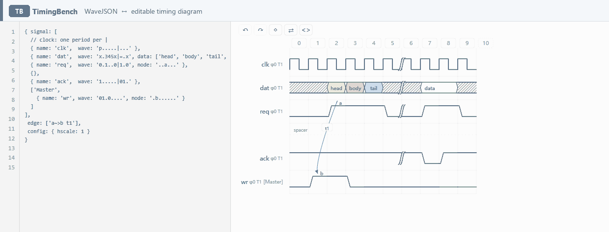

# TimingBench

English · [简体中文](README.zh-CN.md)

**Timing diagrams you edit directly.** Click a waveform cell and the WaveJSON source is rewritten; change the source and the diagram redraws. Neither side is ever treated as the "real" one.

`0.27.2` · [MIT](LICENSE) · runs entirely in your browser · nothing is uploaded · [Open the editor](https://udarent.github.io/TimingBench/editor.html)

Your source is not reformatted behind your back: diagram edits are written back as a minimal patch — comments, indentation, key order and quotes survive — and any result that would not round-trip is rolled back.



> ① Change `p` to `0` in `clk` → the square clock collapses to a flat low level. ② Click a cell and type `1`, `x`, `p` → the same positions are patched back into the source.

If the animation does not show up in your Markdown viewer, [open the GIF directly](https://github.com/udarent/TimingBench/raw/main/assets/bidirectional-demo.gif) — the file is also in [`assets/bidirectional-demo.gif`](assets/bidirectional-demo.gif).

## Start in ten seconds

| Want to… | Do this |
|---|---|
| Try it now | [Open the editor](https://udarent.github.io/TimingBench/editor.html) — phones and tablets switch to the touch layout automatically |
| Learn the format | [The tutorial](https://udarent.github.io/TimingBench/tutorial.html) follows WaveDrom's teaching order: each step is a code block plus a diagram you can click and edit |
| Run a local copy | `git clone https://github.com/udarent/TimingBench.git && cd TimingBench && npm start` → <http://127.0.0.1:5173/> |
| Self-host it | Drop the folder on any static server; for GitHub Pages use `main` / `/ (root)`, no CI needed |

No `npm install`, no network access, no account. The app uses native ES modules, so **opening the files with `file://` does not work** — it has to be served over HTTP.

## Put a diagram in your notes or on a page

Two lines, no build step and no dependency in your project:

```html
<script src="https://udarent.github.io/TimingBench/embed.js"></script>
<div data-timingbench data-height="240"
     data-wavejson='{ signal: [ { name: "clk", wave: "p....." }, { name: "dat", wave: "x.345x." } ] }'></div>
```

Readers see the waveform only. The pen in the corner turns the card into the editor in place; `Esc` or the corner check mark goes back to reading. The card lives in its own iframe, so your styles cannot leak in and its styles cannot leak out.

| What you get | Detail |
|---|---|
| Default state | read-only — waveform only, no buttons |
| Enter / leave editing | the pen in the top-right corner · `Esc` or the check mark to leave |
| Two views while editing | one top-bar toggle — **`{ }` grey** = waveform only, **lit** = waveform + code; a card starts waveform-only and gets the toggle only when it opts in with `data-src="1"` |
| Narrow cards | the diagram scales to the card width, in editing too, so nothing jumps under the cursor |
| On a phone | a cramped card goes fullscreen when you start editing, then draws at 1:1 with normal scrolling; fullscreen is where the **both** view gets its full height |
| Height | the card reports its real height, so there is no blank strip underneath |
| Events | `timingbench:ready` · `timingbench:change` (the new WaveJSON) · `timingbench:mode` |
| Commands | `setSource(wavejson)` · `setMode('view'｜'edit')` · `setHeight(px)` |
| URL params | `?embed=1` (card mode) · `&mode=edit` (start editable) |
| Opt-in UI | `&src=1` (source pane + split view) · `&snippet=1` (the `<>` embed-code button) |

```js
const api = TimingBenchEmbed.mount(el, { wavejson, mode: 'view' });
api.setSource(newSource);
el.addEventListener('timingbench:change', e => console.log(e.detail.wavejson));
```

**A card stays minimal by default.** Its top bar only has undo / redo — the source pane, the split view and the `<>` embed-code button are opt-in, because a 350 px card has no room for them:

```html
<div data-timingbench data-wavejson="…" data-mode="edit" data-src="1" data-snippet="1"></div>
```

`data-src="1"` adds the diagram / code / both switcher, `data-snippet="1"` adds the `<>` button. The standalone editor at `editor.html` turns both on by itself; `?src=0&snippet=0` trims it down to just the waveform.

The `<>` panel writes these for you: it carries the same two toggles (**Source view & split**, **Embed-code button**) above the snippet, both off by default, and adds the matching attributes (or `&src=1` / `&snippet=1` for the iframe form).

**Hosts that never run `<script>`** — an Obsidian note, for instance — can use the `iframe only` tab in the editor's `<>` panel, or this:

```html
<iframe src="https://udarent.github.io/TimingBench/editor.html?embed=1#wj=PAYLOAD"
        style="width:100%;height:auto;aspect-ratio:360 / 96;border:0;border-radius:10px;display:block"
        height="96" loading="lazy" title="Timing diagram"></iframe>
```

`#wj=` carries the WaveJSON inside the URL (base64url), so the snippet is self-contained: copy the note, send the file, publish it — it renders wherever iframes are allowed. The one thing you give up is the `timingbench:change` event. In Obsidian, paste it as a raw HTML block, **not** inside a code fence.

Don't want to hand-write any of this? Draw the diagram in the editor and click `<>` in the top bar: it writes the snippet for your current source, with the right `aspect-ratio`.

## What you can do

- **Edit either side.** Diagram → source through a minimal patch; source → diagram redraws shortly after you stop typing, and keeps the last good picture while you type something invalid (a red dot shows the error).
- **Pick your view.** In the standalone editor a segmented control in the top bar shows **diagram only**, **code only**, or **both** side by side. Embedded cards start on diagram-only, hide the control unless they opt in with `data-src="1"`, and reset when you leave editing — a reader never lands on a screen of raw source.
- **Compact sources get tidied.** When a minified one-line `data-wavejson` or `#wj=` payload is loaded, it is pretty-printed across lines before it reaches the code box. Your own multi-line source — comments and layout included — is left untouched; only sources with no line breaks and no comments are reformatted.
- **Write waveforms fast.** Select a cell and type a character, click it in the character bar, or drag across cells to paint. Each chip in the bar shows the shape it will write.
- **Edit in place.** Double-click a cell, a signal name, a data label, an arc, or a whole `wave` / `data` / `node` row. `phase` and `period` are editable the same way, and both are applied to the drawing.
- **Restructure without the source.** Add or remove rows and cycles, toggle a phase line, reorder rows,
  append a trailing cycle, add spacers — and build groups right on the canvas: select a range of rows,
  give it a name, nest it as deep as you like. No group in the source? It gets created for you.
- **Split however you like.** The divider between source and diagram is draggable: 50/50 by default,
  drag it (or press the arrow keys when it has focus) and that ratio is remembered per orientation;
  double-click to go back to half and half.
- **Phases you can drag.** Click the `φ` badge next to a row and that row turns into a ruler: press anywhere
  to jump, drag to slide the waveform against the reference grid (one cell per period, 0.05 snap).
- **Connect with arcs.** Turn on link mode, click two cells; unused letters are assigned for you. Double-click an arc to change its shape or label, clear it to delete.
- **Undo everything.** A paint drag, a row move and an arc each count as one step.
- **No mouse needed.** Every edit has a shortcut; the canvas takes focus with `Tab` or `F6`.
- **Nothing leaves the page.** No requests, no accounts, no telemetry.

On touch devices the same editor runs in a dedicated layout: 44 px targets, the 23 characters in a dock that slides up from the bottom of the card, and the panes stacked. Nothing is collapsed behind a `⋯` any more (0.26.0): every character and every row / column action is rendered at once and the bar simply wraps onto extra rows — the canvas gives up exactly that much height, so buttons never cover the waveform. Two fingers pinch to zoom the canvas (0.2–4×, shrinking at most until the whole diagram fits; anchored between the fingers) and pan the view; one finger still scrolls natively. On desktop and in embed cards it is `Ctrl`/`⌘` + wheel (a trackpad pinch arrives as exactly that). Read-only cards zoom too, and the height reported to the host stays unchanged. `?touch=1` previews that layout on a desktop.

## Keyboard shortcuts

| Key | Action |
|---|---|
| `Tab` / `F6` | Source → canvas (first cell selected) / canvas → source |
| `←` `→` `↑` `↓` | Move the selected cell (spacer rows are skipped) |
| `Home` / `End` | First / last cycle of the current row |
| `Ctrl+Home` / `Ctrl+End` | First / last cell of the whole diagram |
| `0 1 x z u d p P n N h l H L = 2…9` | Write to the current cell and move right |
| `Shift+←` / `Shift+→` | Write the last character and move that way (paint) |
| `Shift+↑` / `Shift+↓` | Extend the row range up / down (then **group rows** in the action bar) |
| `Enter` | Edit the current cell's waveform character |
| `Shift+Enter` | Edit the current cell's node marker |
| `R` | Rename the current signal |
| `W` / `A` / `S` | Edit the whole `wave` / `data` / `node` row |
| `F` / `T` | Edit `phase` / `period` |
| `B` | Edit the data label of the current bus block |
| `E` / `Shift+E` | Edit the current arc / jump to the next arc |
| `K` | Toggle link mode |
| `O` / `Shift+O` / `X` | Add a signal row / spacer row below · delete the current row |
| `Ctrl+↑` / `Ctrl+↓` | Move the current row up / down |
| `+` / `-` / `G` | Insert / delete a cycle at the current column · toggle its phase line |
| `Shift+A` | Append a cycle at the end |
| `Ctrl/⌘+Z` · `Ctrl/⌘+Y` / `Ctrl+Shift+Z` | Undo · redo |
| `Esc` | Leave link mode, cancel a drag, clear the selection |

In link mode the arrow keys move a separate endpoint cursor; `Enter` or `Space` picks that cell, and the second pick draws the arc and leaves the mode. `Esc` or `K` leaves it early.

## Wave characters

| Group | Characters | Meaning |
|---|---|---|
| Levels | `0` `1` `x` `z` `u` `d` | low · high · unknown (hatched) · high-impedance · pull-up · pull-down |
| Clocks | `p` `n` `h` `l`, and `P` `N` `H` `L` | starting edge or level; the uppercase forms add an arrow on the working edge |
| Bus | `=` `2`…`9` | data block that consumes the next `data` label; the colour follows the digit |
| Auxiliary | `.` `\|` `<` `>` | hold the previous state · phase line · sub-cycle switches |

`data` labels a bus block; `node` marks a cycle so an `edge` can point at it — in `edge: ['a~>b t1']` the first character is the start, the last is the end, `~` is a curve, `-` a straight line, and the text after the space is the label.

## FAQ

- **Are my diagrams uploaded anywhere?** No. Everything is computed in the browser.
- **Does it support all of WaveDrom?** The common subset: `wave` / `data` / `node` / `edge` / `phase` / `period` / `group` / `spacer`, plus repeater fill-in. `period` scales each character's width, `phase` shifts a lane by a whole or fractional number of periods continuously, `config.hscale` widens the time axis (capped at 8). Edge shapes are taken literally — `a-|>b` runs horizontally first, `a|->b` drops first — and an arrowhead appears only when the shape says `<` or `>`. It is not a full WaveDrom implementation and contains none of its code.
- **Which browsers?** Current Chrome, Edge, Firefox and Safari. Older ones without Pointer Events fall back to touch events.
- **My touchscreen laptop stayed in the desktop layout** — the layout follows the primary pointer; append `?touch=1` to force the touch one.
- **Where do the little node circles go?** They are gone on purpose, so the waveform looks like WaveDrom's own rendering — the cells themselves are the connection targets.
- **Known limitations** — the `foreignObject` input with the iOS soft keyboard has not been verified on a real device; touch mode drops drag-paint and drag-to-reorder to keep native scrolling; `head` / `foot` / `gaps` and the row-level `over` / `under` annotations are preserved and round-tripped byte for byte but not drawn; sub-cycle packs (`<` `>`) are kept in the source yet drawn at full width.

## Credits, license and feedback

**Thanks to [WaveDrom](https://github.com/wavedrom/wavedrom) and its contributors** — the WaveJSON format, the editor layout and the default skin's visual style come from there. The exact scope is recorded in [ACKNOWLEDGMENTS.md](ACKNOWLEDGMENTS.md).

[MIT](LICENSE) covers this project's own code ([scope](LICENSE.md)). No upstream source or dependency is included, and there is no affiliation or endorsement.

Found a bug or want a feature? [Open an issue](https://github.com/udarent/TimingBench/issues).
