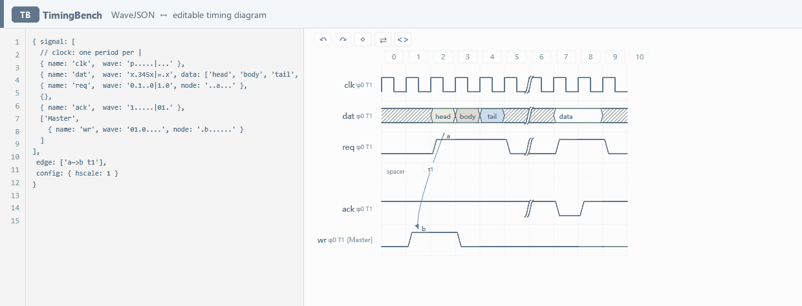

# TimingBench

English · [简体中文](README.zh-CN.md)

**WaveJSON ⇄ editable timing diagrams.** Edit the diagram and the source is rewritten; edit the source and the diagram redraws — both stay in sync.

`0.4.0` · [MIT](LICENSE) · static-only · zero build · zero dependencies · runs entirely locally · [Open online](https://udarent.github.io/TimingBench/)

There is only one source of truth: diagram edits are written back as a minimal patch (comments, indentation, key order and quotes are preserved), and the result is rolled back if it is not equivalent to the diagram. Your source is never silently corrupted.

## See it in action



> ① Change `p` to `0` in `clk` → the square clock collapses to a flat low level. ② Click a cell and write `1`, `x`, `p` → the same positions are patched back into the source. Both directions read the same WaveJSON.

If the animation does not appear in your Markdown viewer, [open the GIF directly](https://github.com/udarent/TimingBench/raw/main/assets/bidirectional-demo.gif). The same recording is in [`assets/bidirectional-demo.gif`](assets/bidirectional-demo.gif).

```js
{ signal: [
    { name: 'clk', wave: 'p.....|...' },
    { name: 'dat', wave: 'x.345x|=.x', data: ['head', 'body', 'tail', 'data'] },
    { name: 'req', wave: '0.1..0|1.0', node: '..a...' },
    { name: 'ack', wave: '1.....|01.' }
  ], edge: ['a~>b t1'] }
```

Open the page and you get this source next to its editable timing diagram. Click the third cell of `req` and type `1`: the waveform changes and the same character is written back into the source. Change `p` to `0` in the source and the clock collapses into a flat low level immediately.

## Quick start

| Goal | How |
|---|---|
| Try it now | [Online editor](https://udarent.github.io/TimingBench/) · phones / tablets switch to the touch layout automatically |
| Run locally | `git clone https://github.com/udarent/TimingBench.git && cd TimingBench && npm start` → <http://127.0.0.1:5173/> |
| Self-host | Put this entire directory on any static server; for GitHub Pages choose `main` / `/ (root)`, no CI needed |
| Preview touch UI on desktop | Append `?touch=1` to the URL |

No `npm install`, no network access, no uploads. Node is used only for the local static server and the pre-commit check. The app uses native ES modules, so **opening `index.html` via `file://` does not work** — it must be served over HTTP.

## What it does

| Feature | Details |
|---|---|
| Bidirectional sync | Diagram → source via a minimal patch; source → diagram redraws ~320 ms after you stop typing; non-equivalent results roll back |
| Waveform editing | Select a cell, then type a character / click the character bar / drag across cells to paint; each chip in the bar shows the waveform it will write |
| Inline editing | Double-click to edit a cell, signal name, data label, arc, a whole `wave` / `data` / `node` row, or `phase` / `period`; `Shift+Enter` edits the node marker of the selected cell |
| Keyboard-only | Every edit — cells, rows, cycles, names, labels, arcs, reordering and link mode — has a shortcut. `Tab` / `F6` focuses the canvas and selects the first cell; `F6` returns to the source |
| Structure editing | Add / remove rows and cycles, phase gaps, row reordering, append a trailing cycle, `group` / `spacer` |
| Nodes and arcs | Click **◇ Link** in the HUD (or the bottom bar on touch), then click two waveform cells; unused letters a–z are assigned automatically; double-click an arc to change its shape / label, clear it to delete |
| Undo / redo | `Ctrl+Z` / `Ctrl+Y`; one paint drag, one row reorder and one arc each count as a single undo step |
| Tolerant parsing | While the source is incomplete, the last valid diagram stays on screen and a red dot shows the error and offset |
| Desktop / touch | Two stacked panes on desktop; coarse-pointer devices get tabs + a bottom action bar instead |
| Privacy | Everything runs in the browser — no requests, no accounts, no backend, no telemetry |

## Operations at a glance

| Goal | Desktop | Touch |
|---|---|---|
| Write a waveform | Click a cell → type / click the character bar; hold and drag horizontally to paint | Tap a cell → tap the character bar (wraps into multiple rows of large chips, no horizontal scrolling) |
| Inline edit | Double-click the target (or `Enter` on a selected cell) | Double-tap the same target within 330 ms, or long-press for 480 ms |
| Connect an arc | Click ◇ Link → click two waveform cells (dashed preview follows the pointer) → the mode exits once the arc is drawn | Tap ◇ Link in the bottom bar → tap two waveform cells (a toast confirms the first tap) |
| Rows / cycles / phase gaps | Hover the right edge of a row or a column number for `+` `−` `\|` | 14 always-visible buttons in the "Object" panel + 4 in the "Column" panel |
| Reorder rows | Drag the ⠿ handle at the row start | `↑ Move up` / `↓ Move down` |
| Undo / redo | Top ↶ ↷ or `Ctrl+Z` / `Ctrl+Y` | `↶ Undo` / `↷ Redo` in the bottom bar |
| Cancel current mode | `Esc` | `✕ Cancel` in the bottom bar |
| See source / diagram | Both panes visible at once | Switch with the "Diagram / Source" tabs |

Touch hit targets follow the 44 CSS px guideline (cells 46×50, character chips 44×44, action-bar buttons ≥48). Hover-only mini controls are removed. Default gestures are not blocked, so native canvas scrolling and pinch-zoom still work.

No mouse at all? Every row / cycle / arc / structure action in this table has a key — see the shortcuts below. The canvas shows a focus ring only when reached by keyboard.

## Keyboard shortcuts

| Key | Action |
|---|---|
| `Tab` / `F6` | Source → canvas (auto-selects the first cell) / canvas → source |
| `←` `→` `↑` `↓` | Move the selected cell (skips spacer rows) |
| `Home` / `End` | First / last cycle of the current row |
| `Ctrl+Home` / `Ctrl+End` | First / last cell of the whole diagram |
| `0 1 x z u d p P n N h l H L = 2…9` | Write to the current cell and move right (see the table below) |
| `Shift+←` / `Shift+→` | Paint: write the last character and move in that direction |
| `Enter` | Inline-edit the current cell (waveform character) |
| `Shift+Enter` | Inline-edit the node marker of the current cell |
| `R` | Rename the current signal |
| `W` / `A` / `S` | Inline-edit the whole `wave` / `data` / `node` row |
| `F` / `T` | Inline-edit `phase` / `period` |
| `B` | Inline-edit the data label of the current bus block |
| `E` / `Shift+E` | Edit the current arc / switch to the next arc (clear the input to delete it) |
| `K` | Toggle link mode |
| `O` / `Shift+O` / `X` | Add a signal row / spacer row below, or delete the current row |
| `Ctrl+↑` / `Ctrl+↓` | Move the current row up / down |
| `+` / `-` / `G` | Insert / delete a cycle at the current column, toggle its phase gap |
| `Shift+A` | Append a cycle at the end |
| `Ctrl/⌘ + Z` · `Ctrl/⌘ + Y` / `Ctrl+Shift+Z` | Undo · redo |
| `Esc` | Exit link mode, cancel a drag, or clear the selection |

### In link mode

| Key | Action |
|---|---|
| `←` `→` `↑` `↓` · `Home` / `End` | Move the endpoint cursor (a dashed rectangle, separate from the normal selection) |
| `Enter` / `Space` | Pick the current cell as an endpoint; the second pick draws the arc and exits link mode |
| `Esc` / `K` | Exit link mode early |
| `Ctrl+Z` / `Ctrl+Y` | Undo · redo (still available) |

Shortcuts apply when focus is outside the source editor and the inline input: `Tab` reaches the canvas in DOM order, `F6` switches explicitly, and buttons keep their native keyboard behaviour. Inline inputs commit with `Enter`, cancel with `Esc` and return focus to the canvas.

The 23 characters above are the writable waveform set. `.` (hold), `|` (phase gap) and `<` / `>` (sub-cycle) are WaveJSON syntax: write them in the source, or press `G` to toggle a phase gap at the current column.

## Wave character reference

| Group | Characters | Meaning |
|---|---|---|
| Levels | `0` `1` `x` `z` `u` `d` | low · high · unknown (hatched) · high-impedance · pull-up · pull-down |
| Clocks | `p` `n` `h` `l`; uppercase `P` `N` `H` `L` | starting edge / level variants; uppercase adds an arrow |
| Bus | `=` `2`…`9` | data block consuming `data` labels in order; color varies with the digit |
| Auxiliary | `.` `\|` `<` `>` | hold the previous state (no label consumed) · phase gap · sub-cycle switches (no cycle consumed) |
| Nodes / arcs | `node: '..a...'`, `edge: ['a~>b t1']` | markers map to cycle positions; in an edge the first character is the start and the last is the end, `~` curve / `-` straight / `>` arrow in between, text after the space is the label |

Missing trailing cycles are drawn repeater-style with the last state (slightly dimmed); clicking one extends both the source and the diagram, and the change is undoable.

## FAQ and limitations

- **Can I use it without a mouse?** Yes. `Tab` or `F6` focuses the canvas and selects the first cell; the shortcuts above cover every edit, including `K` → arrow keys → `Enter` → arrow keys → `Enter` to draw an arc with no pointer at all. `F6` takes you back to the source editor.
- **Where did the node markers / little circles go?** They are gone, so the waveform looks like WaveDrom's own rendering. The cells themselves are the connection targets: click ◇ Link, then pick two cells. While link mode is on nothing else responds — character chips, keyboard writing, double-click editing and selection are suspended until the arc is drawn or `Esc` is pressed.
- **Nothing happens when I double-click the HTML file?** ES modules are blocked by CORS under `file://`. Use `npm start` or any static server; a GitHub Pages deployment works out of the box.
- **Are my diagrams uploaded anywhere?** No. Everything is computed in the browser — no requests, no storage, no account.
- **Does it support all of WaveDrom?** It covers the common subset: `wave` / `data` / `node` / `edge` / `phase` / `period` / `group` / `spacer` and repeater-style fill-in. It is not a full WaveDrom implementation and contains none of its code.
- **Which browsers?** Current Chrome / Edge / Firefox / Safari (ES modules, SVG `foreignObject`, Pointer Events). Older browsers without Pointer Events fall back to touch events.
- **My touchscreen laptop stayed in desktop mode?** If the primary pointer is a mouse, the layout does not switch automatically; append `?touch=1` to force it.
- **Known limitations**: the `foreignObject` input with the iOS Safari soft keyboard has not been verified on a real device; touch mode drops drag-paint and drag-to-reorder (to avoid stealing native scroll gestures), and arcs have no finger-following preview curve.

## Development

`npm run check` runs the pre-commit self-check (bidirectional equivalence, site assets, module imports, version consistency) and exits 1 on failure. The full test suite is not shipped in this repository.

## Credits, license and feedback

**Thanks to [WaveDrom](https://github.com/wavedrom/wavedrom) and its contributors** — without WaveDrom and the WaveJSON format it introduced, TimingBench would not exist. Its editor layout, the public format and the default skin's visual style are this project's design reference; the exact scope is recorded in [ACKNOWLEDGMENTS.md](ACKNOWLEDGMENTS.md).

[MIT](LICENSE) covers only this project's own code ([scope](LICENSE.md)). No upstream source or dependency is included, and there is no affiliation or endorsement.

**Feedback is very welcome** — for bugs, ideas or questions, please [open an issue](https://github.com/udarent/TimingBench/issues).
