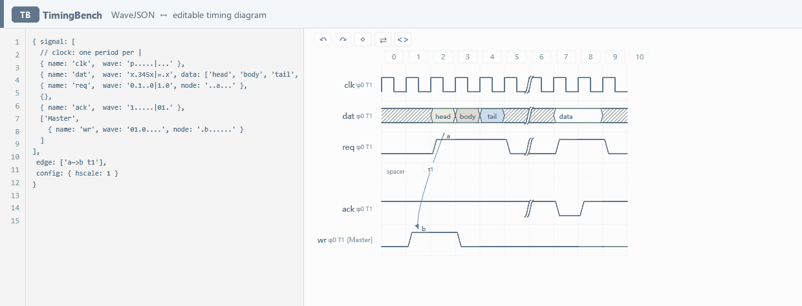

# TimingBench

[English](README.md) · 简体中文

**WaveJSON ⇄ 可编辑时序图。** 改图形回写源码，改源码重绘图形，两侧实时同步。

`0.9.20` · [MIT](LICENSE) · 纯静态 · 零构建 · 零依赖 · 完全本地运行 · [在线打开](https://udarent.github.io/TimingBench/editor.html)

两侧只有一份语义：图形回写优先打最小补丁（注释、缩进、键序、引号原样保留），生成结果若与图形不等价就回滚，不会静默改坏你的源码。

## 嵌入到你的页面

两行，不需要构建、不需要在项目里装依赖：

```html
<script src="https://udarent.github.io/TimingBench/embed.js"></script>
<div data-timingbench data-height="240"
     data-wavejson='{ signal: [ { name: "clk", wave: "p....." }, { name: "dat", wave: "x.345x." } ] }'></div>
```

卡片**默认只读**——读者只看到波形；点一下就在原地变成可编辑，按 `Esc`（或点右下角的铅笔图标）回到查看。窄卡片会把整张图**等比缩放到卡片宽度**，读者一眼看全，不用横向拖；**编辑态沿用同一个缩放比**，不跳回 1:1 —— 手指底下的内容不会被挪走。它跑在自己的 iframe 里，宿主页面的 CSS 进不来、它的样式也污染不到宿主。

不想手写这段代码？在[工作台](https://udarent.github.io/TimingBench/editor.html)里画好图，点页面顶栏最后一个图标 `<>`，它会按当前源码生成上面那段片段，一键复制即可。

**宿主不让跑脚本？** 有些地方只渲染 HTML、从不执行 `<script>` —— Obsidian 笔记就是典型。这时用同一个 `<>` 面板里的 `iframe only` 页签，或者自己写：内容藏在 URL 里，不需要任何脚本。

```html
<iframe src="https://udarent.github.io/TimingBench/editor.html?embed=1#wj=PAYLOAD"
        style="width:100%;height:auto;aspect-ratio:560 / 376;border:0;border-radius:10px;display:block"
        height="376" loading="lazy" title="Timing diagram"></iframe>
```

`#wj=` 后面就是 WaveJSON 本体（base64url，因此不用转义、也不经过服务器）。这意味着片段是**自包含**的：转发笔记、发文件、发布出去，只要对方允许 iframe 就能看到图。`aspect-ratio` 让高度按图自身的比例跟着容器宽度走，**下方不会再留一条空白**（写死 `height="…"` 在窄屏上就会空出一大截）；`height` 只是老浏览器的兜底，比例值要与你的图一致（`<>` 面板生成的就是对的）。剩下的代价是没有 `timingbench:change` 事件 —— 没有加载器在跑。Obsidian 里要作为**原始 HTML 块**直接贴进笔记，不能放在代码围栏里。

这种形态同样是完整可交互的卡片：默认只读，点一下就地编辑 —— 同一个编辑器，只是少了加载器。想一进来就可编辑？把 `&mode=edit` 加在 `#` 前面：`…?embed=1&mode=edit#wj=…`。

想用代码控制？

```js
const api = TimingBenchEmbed.mount(el, { wavejson, mode: 'view' });  // 或 'edit'
api.setSource(新源码);
api.setMode('edit');

el.addEventListener('timingbench:change', e => {
  console.log('用户改了图，最新源码：', e.detail.wavejson);
});
```

| 行为 | 说明 |
|---|---|
| 默认状态 | 只读（只有波形，没有按钮） |
| 进入编辑 | 点一下波形，顺手选中被点的格子 |
| 退出编辑 | `Esc`，或点右下角的铅笔图标（编辑中变对勾） |
| 高度自适应 | 卡片通过 `postMessage` 上报真实高度，`embed.js` 自动应用 |
| 宿主事件 | `timingbench:ready` · `timingbench:change` · `timingbench:mode` |
| 宿主命令 | `setSource(wavejson)` · `setMode('view'｜'edit')` · `setHeight(px)` |
| 参数 | `?embed=1`（卡片模式）· `&mode=edit`（一进来就可编辑） |
| 强制只读 | 占位元素上加 `data-mode="view"` |

可直接跑的示例：[`embed-demo.html`](embed-demo.html)（`npm start` 后打开）。

## 先看一个例子



> ① 源码里把 `clk` 的 `p` 改成 `0` → 方波时钟立刻塌成一条低电平直线；② 点画布格子依次写入 `1`、`x`、`p` → 源码对应位置同步回写。两侧始终是同一份 WaveJSON。

如果你的 Markdown 阅读器不显示动图，[点此直接打开 GIF](https://github.com/udarent/TimingBench/raw/main/assets/bidirectional-demo.gif)。同一份录屏也在 [`assets/bidirectional-demo.gif`](assets/bidirectional-demo.gif)。

```js
{ signal: [
    { name: 'clk', wave: 'p.....|...' },
    { name: 'dat', wave: 'x.345x|=.x', data: ['head', 'body', 'tail', 'data'] },
    { name: 'req', wave: '0.1..0|1.0', node: '..a...' },
    { name: 'ack', wave: '1.....|01.' }
  ], edge: ['a~>b t1'] }
```

打开页面就是这段源码和它对应的可编辑时序图。点 `req` 第 3 格敲 `1`，波形立刻变化，源码里同一格字符也跟着变；反过来把源码里的 `p` 改成 `0`，整行时钟立刻塌成一条低电平直线。

## 快速开始

| 场景 | 做法 |
|---|---|
| 直接试 | [在线编辑器](https://udarent.github.io/TimingBench/editor.html) · 手机 / 平板自动切换触摸版式 |
| 本地跑 | `git clone https://github.com/udarent/TimingBench.git && cd TimingBench && npm start` → <http://127.0.0.1:5173/> |
| 自托管 | 把整个目录放到任意静态服务器；GitHub Pages 选 `main` / `/ (root)`，无需 CI |
| 桌面预览触摸版式 | 地址后加 `?touch=1` |

不需要 `npm install`、不联网、不上传任何数据；Node 只用于本地静态服务与提交前自检。页面用原生 ES modules，**双击 `index.html` 用 `file://` 打开不生效**，必须经 HTTP 访问。

## 能做什么

| 能力 | 说明 |
|---|---|
| 双向同步 | 图 → 码最小补丁回写；码 → 图停止输入约 320ms 后重绘；两侧不等价自动回滚 |
| 波形编辑 | 点格子选中后键盘直敲 / 点字符条 / 按住横向拖动漫刷；字符条的背景图案就是写入后的波形 |
| 就地编辑 | 双击改格子、信号名、数据标签、弧线、整行 `wave` / `data` / `node`、`phase` / `period`；选中格后 `Shift+Enter` 改该格节点字符 |
| 全键盘编辑 | 格子、行列、周期、信号名、标签、弧线、重排与连线都有快捷键；`Tab` / `F6` 进入画布并自动选中首格，`F6` 回到源码 |
| 结构编辑 | 增删行与周期、相位线、行重排、末尾追加周期、`group` / `spacer` |
| 节点与弧线 | 选中波形后点底部动作行的「◇ 连线」开启模式，再点两个波形格；自动分配 a–z 中未用的最小字母；双击弧线改形状 / 标签，清空即删除 |
| 撤销重做 | `Ctrl+Z` / `Ctrl+Y`（或顶栏的 ↶ ↷）；一次漫刷、一次移行、一次连线各自只算一次撤销 |
| 语法容错 | 源码没写完时保留上次有效图形，右上角红点给出错误与偏移 |
| 桌面 / 触摸 | 桌面左代码 / 右时序图（窄窗口回退上下）；粗指针设备两区同屏，方向用 HUD 的 ⇄ / ⇅ 切换并记住 |
| 隐私 | 全部在浏览器内计算，无网络请求、无账号、无后端、无遥测 |

## 操作速查

| 想做的事 | 桌面 | 触摸 |
|---|---|---|
| 写波形 | 点格子 → 敲字符 / 点字符条；按住左键横向拖动连写 | 点格子 → 底部升起字符停靠条：`0 1 x z` + `⋯` 展开全部 23 个，命中区 48px |
| 就地编辑 | 双击目标（或选中后 `Enter`） | 同目标 330ms 内双敲，或长按 480ms |
| 连弧线 | 点底部动作行的「◇ 连线」→ 点两个波形格（虚线预览跟随鼠标）→ 成线后自动退出模式 | 点底部动作行的「◇ 连线」→ 依次点两个波形格（轻提示确认第一下） |
| 行列 / 相位线 | 选中行 / 列 → 右侧上下文条（行 11 个 / 列 4 个动作） | 选中行 / 列 → 底部上下文条（同一套图标） |
| 行重排 | 选中行 → 上下文条 `↑` / `↓`（或 `Ctrl+↑↓`） | 同左 |
| 撤销 / 重做 | 页面顶栏的 ↶ ↷，或 `Ctrl+Z` / `Ctrl+Y` | 页面顶栏的 ↶ ↷ |
| 取消当前状态 | `Esc` | 点画布空白（四场景一致） |
| 看源码 / 看图 | 左代码 / 右时序图同屏可见 | 两区同屏，方向用 HUD 的 ⇄ / ⇅ 切 |
| 改单格标签 / 节点 | 选中格 → 上下文条 `✎` / 节点图标（或 `B` / `Shift+Enter`） | 选中格 → 底部上下文条的两个格级图标 |

TimingBench 按**波形卡片**设计：需要的操作都在卡片可视范围内。触摸端命中区按 44 CSS px 放大（格子 46×50、停靠条字符按钮 48×44、上下文条图标 44×44），hover 才显现的小按钮全部撤下（改由上下文条承担）。触摸端的 23 个字符放在卡片底部的**停靠条**里（不再浮在波形上），滑动看图时按钮不会跟着跑。波形本身是一个可缩放的对象：**内容比容器宽时整张图等比缩到容器宽**，手机竖屏一屏看全、不用横向拖（代价是格子物理尺寸随比例变小，390px 屏约 28px）；**操作层（顶栏与底部两条）不参与缩放** —— 顶栏跨两栏、动作条与字符条按卡片的**可视宽度**换行堆叠，宁可卡片变高也不让按钮横向溢出，任何按钮都不需要横向滚动才能点到。320px 下 23 个字符条排成 4 行，全部操作仍在卡片内可达。不阻止默认手势，纵向原生滚动与双指缩放照常可用。

完全没有鼠标？上表里每类行 / 列 / 弧线 / 结构操作都有对应按键，见下方快捷键表；画布只在键盘聚焦时显示焦点框。

## 快捷键

| 键 | 作用 |
|---|---|
| `Tab` / `F6` | 源码 → 画布（自动选中首格）/ 画布 → 源码 |
| `←` `→` `↑` `↓` | 移动选中格（自动跳过 spacer 空行） |
| `Home` / `End` | 本行首 / 末周期 |
| `Ctrl+Home` / `Ctrl+End` | 全图首格 / 末格 |
| `0 1 x z u d p P n N h l H L = 2…9` | 写入当前格并自动右移（含义见下表） |
| `Shift+←` / `Shift+→` | 漫刷：写入上次字符并朝该方向移动 |
| `Enter` | 就地编辑当前格（波形字符） |
| `Shift+Enter` | 就地编辑当前格的节点字符 |
| `R` | 重命名当前信号 |
| `W` / `A` / `S` | 就地编辑整行 `wave` / `data` / `node` |
| `F` / `T` | 就地编辑 `phase` / `period` |
| `B` | 就地编辑当前数据块的 data 标签 |
| `E` / `Shift+E` | 编辑当前弧线 / 切到下一条（清空即删除） |
| `K` | 开关连线模式 |
| `O` / `Shift+O` / `X` | 下方新增信号行 / 空行 / 删除当前行 |
| `Ctrl+↑` / `Ctrl+↓` | 上移 / 下移当前行 |
| `+` / `-` / `G` | 当前列插入 / 删除周期、切换相位线 |
| `Shift+A` | 末尾追加一个周期 |
| `Ctrl/⌘ + Z` · `Ctrl/⌘ + Y` / `Ctrl+Shift+Z` | 撤销 · 重做 |
| `Esc` | 退出连线模式 / 取消拖动 / 清除选中 |

### 连线模式下

| 键 | 作用 |
|---|---|
| `←` `→` `↑` `↓` · `Home` / `End` | 移动端点光标（虚线框，与普通选中框互斥） |
| `Enter` / `Space` | 把当前格选为端点；第二下成线并自动退出模式 |
| `Esc` / `K` | 提前退出连线模式 |
| `Ctrl+Z` / `Ctrl+Y` | 撤销 · 重做（仍然可用） |

快捷键在焦点不在源码框 / 就地输入框时生效：`Tab` 按 DOM 顺序到达画布，`F6` 显式切换，焦点在按钮等控件上时保留浏览器原生行为。就地输入框 `Enter` 确认、`Esc` 取消，结算后焦点自动回到画布。

上表 23 个字符是可写入的波形集合。`.`（延续）、`|`（相位线）与 `<` / `>`（子周期）属于 WaveJSON 语法：在源码里写，或按 `G` 切换当前列的相位线。

## wave 字符速查

| 类别 | 字符 | 效果 |
|---|---|---|
| 电平 | `0` `1` `x` `z` `u` `d` | 低 · 高 · 未知（斜线阴影）· 高阻 · 上拉 · 下拉 |
| 时钟 | `p` `n` `h` `l`；大写 `P` `N` `H` `L` | 起始跳变沿 / 电平变体；大写额外带箭头 |
| 总线 | `=` `2`…`9` | 数据块，按序消耗 `data` 标签，配色随数字变化 |
| 辅助 | `.` `\|` `<` `>` | 延续前一状态（不消耗标签）· 相位线 · sub-cycle 开关（不占周期） |
| 节点 / 弧线 | `node: '..a...'`、`edge: ['a~>b t1']` | 标记按周期位置对应；edge 首字符为起点、末字符为终点，中间 `~` 曲线 / `-` 直线 / `>` 箭头，空格后是标签 |

短行缺失的周期按 repeater 沿用最后一状态补画（略淡），点它写入会自动扩展源码与图形，可撤销。

## 你可能会问

- **不用鼠标能完成全部编辑吗？** 能。`Tab` 或 `F6` 把焦点移到画布并自动选中首格，上表快捷键覆盖所有操作，包括 `K` → 方向键 → `Enter` → 方向键 → `Enter` 纯键盘连弧线；`F6` 再回到源码框。
- **节点小圆圈去哪了？** 已移除，波形呈现更接近 WaveDrom 原始渲染。波形格本身就是连线端点：点「◇ 连线」开启模式后依次点两格即可。连线模式下其它操作一律不响应 —— 字符条、键盘写入、双击就地编辑与选中都暂停，直到成线或按 `Esc` 退出。
- **双击 HTML 打不开？** ES modules 受 `file://` 的 CORS 限制，用 `npm start` 或任意静态服务器访问；GitHub Pages 部署天然可用。
- **我的时序图会上传到服务器吗？** 不会。纯前端计算，没有请求、没有存储、没有账号。
- **支持 WaveDrom 全部语法吗？** 支持常用子集：`wave` / `data` / `node` / `edge` / `phase` / `period` / `group` / `spacer` 与 repeater 补画。不是 WaveDrom 的完整实现，也不含其代码。
- **哪些浏览器？** 现代 Chrome / Edge / Firefox / Safari（需 ES modules、SVG `foreignObject`、Pointer Events）；缺少 Pointer Events 的老浏览器触摸端回退 touch 事件。
- **触屏笔记本没切换版式？** 主指针是鼠标时不自动切换，地址后加 `?touch=1` 强制预览。
- **已知限制**：iOS Safari 软键盘配合 `foreignObject` 输入框尚未真机验证；触摸端不做按住拖过连写与拖动重排（避免抢原生滚动手势），连线没有跟随手指的预览曲线。

## 开发

`npm run check` 跑提交前自检（双向等价、站点资源、模块引用、版本一致），失败退出码 1。完整验收套件不在本仓库内。

## 致谢、许可与反馈

**感谢 [WaveDrom](https://github.com/wavedrom/wavedrom) 项目及其贡献者** —— 没有 WaveDrom 与它定义的 WaveJSON 格式，就不会有 TimingBench。本项目在设计上参考了它的编辑器版式、公开格式与默认皮肤的视觉风格，具体参照范围见 [ACKNOWLEDGMENTS.md](ACKNOWLEDGMENTS.md)。

[MIT](LICENSE) 许可只覆盖本项目自有内容（[范围说明](LICENSE.md)）；不含上游源码或依赖，也不构成隶属或背书关系。

**欢迎反馈** —— 遇到 bug、有想法或疑问，请直接[提 issue](https://github.com/udarent/TimingBench/issues)。
