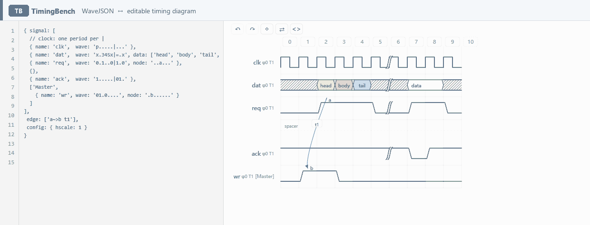

# TimingBench

[English](README.md) · 简体中文

**直接改波形就能改源码的时序图编辑器。** 点一下波形格，WaveJSON 源码就同步改写；改一下源码，波形立刻重画。两边都不是「附属品」。

`0.27.9` · [MIT](LICENSE) · 完全跑在浏览器里 · 不上传任何内容 · [打开编辑器](https://udarent.github.io/TimingBench/editor.html)

源码不会被悄悄重排：图形编辑以**最小补丁**写回源码（注释、缩进、键序、引号原样保留），任何无法无损往返的结果都会回滚。



> ① 把 `clk` 的 `p` 改成 `0` → 方波塌成一条低电平。② 点一个格子输入 `1`、`x`、`p` → 同样的位置被补丁写回源码。

如果你的 Markdown 阅读器不显示动图，可[直接打开 GIF](https://github.com/udarent/TimingBench/raw/main/assets/bidirectional-demo.gif)，文件也在 [`assets/bidirectional-demo.gif`](assets/bidirectional-demo.gif)。

## 十秒上手

| 想做的事 | 怎么做 |
|---|---|
| 立刻试用 | [打开编辑器](https://udarent.github.io/TimingBench/editor.html) —— 手机、平板自动切到触摸版式 |
| 学这个格式 | [教程页](https://udarent.github.io/TimingBench/tutorial.html) 按 WaveDrom 的教学顺序：每步一段代码 + 一张可点即编辑的图 |
| 跑本地副本 | `git clone https://github.com/udarent/TimingBench.git && cd TimingBench && npm start` → <http://127.0.0.1:5173/> |
| 自己托管 | 整个目录丢到任意静态服务器；GitHub Pages 选 `main` / `/ (root)`，不需要 CI |

不需要 `npm install`、不联网、不用注册。应用用的是原生 ES modules，所以**直接双击文件（`file://`）打不开**，必须用 HTTP 访问。

## 把时序图放进笔记或网页

两行搞定，不需要构建，也不用给项目加依赖：

```html
<script src="https://udarent.github.io/TimingBench/embed.js"></script>
<div data-timingbench data-height="240"
     data-wavejson='{ signal: [ { name: "clk", wave: "p....." }, { name: "dat", wave: "x.345x." } ] }'></div>
```

读者只看到波形；点一下这张卡就地变成编辑器，`Esc` 或右下角对勾回到阅读状态。卡片跑在自己的 iframe 里，你的样式污染不进去，它的样式也漏不出来。

| 你会得到 | 说明 |
|---|---|
| 默认状态 | 只读 —— 只有波形，没有按钮 |
| 进 / 出编辑 | 点波形进入 · `Esc` 或右下角按钮退出 |
| 编辑时的两种视图 | 顶栏一个切换键：**`{ }` 灰** = 只看波形，**点亮** = 波形 + 代码；嵌入卡片默认只看波形，加 `data-src="1` 才会出现这个键 |
| 窄卡片 | 整张图等比缩到卡片宽度，编辑时也一样，光标底下的内容不会跳 |
| 手机上 | 卡片太小时进编辑会自动全屏，之后按 1:1 画、靠滑动移动；**双栏**的高度在全屏里才够用 |
| 高度 | 卡片上报真实高度，下方不会留一条空白 |
| 事件 | `timingbench:ready` · `timingbench:change`（新的 WaveJSON） · `timingbench:mode` |
| 命令 | `setSource(wavejson)` · `setMode('view'｜'edit')` · `setHeight(px)` |
| 地址参数 | `?embed=1`（卡片模式） · `&mode=edit`（一进来就可编辑） |
| 可选入口 | `&src=1`（源码视图 + 双栏） · `&snippet=1`（顶栏「<>」生成嵌入代码） |

```js
const api = TimingBenchEmbed.mount(el, { wavejson, mode: 'view' });
api.setSource(newSource);
el.addEventListener('timingbench:change', e => console.log(e.detail.wavejson));
```

**卡片默认是极简的。** 顶栏只有 撤销 / 重做 —— 源码视图、双栏、`<>` 生成嵌入代码都要显式打开（三四百像素宽的卡片放不下）：

```html
<div data-timingbench data-wavejson="…" data-mode="edit" data-src="1" data-snippet="1"></div>
```

`data-src="1"` 加「图形 / 代码 / 双栏」切换，`data-snippet="1"` 加 `<>`。独立编辑页 `editor.html` 默认两项都开；加 `?src=0&snippet=0` 可以把它也收成只剩波形。

`<>` 面板会替你写这些：片段上方有同名两个勾选框（**Source view & split**、**Embed-code button**），默认都不勾，勾上就往片段里补对应属性（iframe 形态则是 `&src=1` / `&snippet=1`）。

**宿主不执行 `<script>`**（例如 Obsidian 笔记）时，用编辑器 `<>` 面板里的 `iframe only` 标签，或直接写：

```html
<iframe src="https://udarent.github.io/TimingBench/editor.html?embed=1#wj=PAYLOAD"
        style="width:100%;height:auto;aspect-ratio:360 / 96;border:0;border-radius:10px;display:block"
        height="96" loading="lazy" title="Timing diagram"></iframe>
```

`#wj=` 把 WaveJSON 装在 URL 里（base64url），所以这段片段是自包含的：复制笔记、发文件、发布网页都行，只要能放 iframe 就能画出来。代价是没有 `timingbench:change` 事件。粘进 Obsidian 时请作为**原始 HTML 块**，不要放进代码围栏。

不想手写片段？在编辑器里画好图，点顶栏的 `<>`，它会按当前源码生成片段并填好 `aspect-ratio`。

## 能做什么

- **两边都能改。** 图形 → 源码走最小补丁；源码 → 图形在你停手后重画，输入到一半写错时保留上一张好图（红点标出错误位置）。
- **视图一键切换。** 顶栏的 `{ }` 键在**只看波形**与**波形 + 代码**之间切换（灰 = 代码区关着，亮 = 开着）；嵌入卡片默认只看波形（不显示这个键，加 `data-src="1"` 才有），退出编辑自动复位。
- **压缩源码自动排版。** 载入压缩成单行的 `data-wavejson` 或 `#wj=` 内容时，会先排成多行再放进代码框；你自己写的多行源码（含注释与排版）原样保留 —— 只有没有换行、没有注释的源码才会被重排。
- **写波形很快。** 选中格子后敲字符、点字符条，或按住横向拖过连写；字符条里每个按钮就画着它会写入的形状。
- **就地改一切。** 双击格子、信号名、数据标签、弧线，或整行 `wave` / `data` / `node`；`phase` 与 `period` 同样可改，且都会作用到图形上。
- **不动源码也能改结构。** 增删行与周期、切换相位线、上下移动行、末尾追加周期、加分隔行；
  分组直接在波形图上建 —— 选中一段行、起个名字就行，想嵌几层嵌几层。源码里原本没有组也会自动创建。
- **双栏随你分。** 源码与波形之间那条分隔线可以拖：默认各占 50%，拖到哪儿记到哪儿（左右与上下各存一份），
  键盘方向键也能调，双击回到各半。
- **相位可以拖。** 点行名旁的 `φ` 徽标，这一行就变成一条尺子：按下即跳到该处、按住左右拖，
  波形相对参考网格连续平移（一格一个周期，吸附 0.05）。
- **连线。** 打开连线模式点两个格子，未用的字母自动分配；双击弧线改形状或标签，清空即删除。
- **随手撤销。** 一次连写拖动、一次行移动、一条弧线，各算一步。
- **不用鼠标。** 每个操作都有快捷键，画布用 `Tab` 或 `F6` 取焦点。
- **什么都不外传。** 没有请求、没有账号、没有埋点。

触摸设备上是同一套编辑器的专门版式：44px 的可点区域、23 个字符从卡片底部升起的停靠条、双栏堆叠。不再有「⋯」折叠（0.26.0）：23 个字符与全部行 / 列动作一次铺开，宽度不够就换行，停靠区随之长高、画布等量让位 —— 按钮永远可见，也永远不盖住波形。双指捏合缩放画布（0.2~4 倍，最小到「整图装下」；锚点钉在两指中点）、双指平移视图，单指仍是原生滚动；桌面与嵌入卡片用 `Ctrl`/`⌘` + 滚轮（触控板捏合同一条路）。只读卡片也能放大，且上报给宿主的高度不跟着变。桌面端加 `?touch=1` 可以预览。

## 快捷键

| 按键 | 作用 |
|---|---|
| `Tab` / `F6` | 源码 → 画布（自动选中首格）/ 画布 → 源码 |
| `←` `→` `↑` `↓` | 移动选中格（跳过分隔行） |
| `Home` / `End` | 当前行的首 / 末周期 |
| `Ctrl+Home` / `Ctrl+End` | 全图首 / 末格 |
| `0 1 x z u d p P n N h l H L = 2…9` | 写入当前格并右移 |
| `Shift+←` / `Shift+→` | 用上一个字符连写并朝该方向移动 |
| `Shift+↑` / `Shift+↓` | 向上 / 向下扩一行范围（再用上下文条的「组」归组） |
| `Enter` | 改当前格的波形字符 |
| `Shift+Enter` | 改当前格的节点字符 |
| `R` | 重命名当前信号 |
| `W` / `A` / `S` | 改整行 `wave` / `data` / `node` |
| `F` / `T` | 改 `phase` / `period` |
| `B` | 改当前数据块的标签 |
| `E` / `Shift+E` | 改当前弧线 / 跳到下一条弧线 |
| `K` | 开关连线模式 |
| `O` / `Shift+O` / `X` | 在下方插信号行 / 分隔行 · 删除当前行 |
| `Ctrl+↑` / `Ctrl+↓` | 上移 / 下移当前行 |
| `+` / `-` / `G` | 在当前列插入 / 删除周期 · 切换该列相位线 |
| `Shift+A` | 末尾追加一个周期 |
| `Ctrl/⌘+Z` · `Ctrl/⌘+Y` / `Ctrl+Shift+Z` | 撤销 · 重做 |
| `Esc` | 退出连线模式、取消拖拽、清空选中 |

连线模式下方向键移动的是独立的端点光标，`Enter` 或 `Space` 取该格为端点，第二次取点成线并退出；`Esc` 或 `K` 提前退出。

## 波形字符

| 类别 | 字符 | 含义 |
|---|---|---|
| 电平 | `0` `1` `x` `z` `u` `d` | 低 · 高 · 未知（打斜线） · 高阻 · 上拉 · 下拉 |
| 时钟 | `p` `n` `h` `l`，以及大写 `P` `N` `H` `L` | 起始边沿或电平；大写会在有效边沿加箭头 |
| 总线 | `=` `2`…`9` | 数据块，按顺序消耗下一个 `data` 标签；颜色随数字变化 |
| 辅助 | `.` `\|` `<` `>` | 延续上一状态 · 相位线 · 子周期开关 |

`data` 给总线块贴标签；`node` 在某周期放一个锚点字母，`edge` 才能指向它 —— `edge: ['a~>b t1']` 里首字符是起点、末字符是终点，中间 `~` 是曲线、`-` 是直线，空格后是标签。

## 常见问题

- **我的图会被上传吗？** 不会，全部在浏览器里算完。
- **支持 WaveDrom 全部语法吗？** 支持常用子集：`wave` / `data` / `node` / `edge` / `phase` / `period` / `group` / `spacer`，以及 repeater 补画。`period` 把每格拉宽 N 倍、`phase` 把整行连续左移若干周期、`config.hscale` 把整条时间轴加宽（上限 8）。edge 形状按字面解释 —— `a-|>b` 先横后竖、`a|->b` 先竖后横 —— 只有写了 `<` / `>` 才画箭头。不是完整实现，也不含上游代码。
- **支持哪些浏览器？** 现代 Chrome、Edge、Firefox、Safari；缺 Pointer Events 的老浏览器回退触摸事件。
- **触屏笔记本没切到触摸版式？** 版式跟随主指针；地址后加 `?touch=1` 强制切换。
- **节点小圆圈去哪了？** 有意去掉，波形更接近 WaveDrom 原始渲染 —— 格子本身就是连线端点。
- **已知限制** —— iOS 软键盘配合 `foreignObject` 输入框尚未真机验证；触摸端不做按住拖过连写与拖动重排（避免抢原生滚动）；`head` / `foot` / `gaps` 与行级 `over` / `under` 标注会被保留并逐字节原样往返，但暂未绘制；sub-cycle（`<` `>`）保留在源码里、按整格宽度画。

## 致谢、许可与反馈

**感谢 [WaveDrom](https://github.com/wavedrom/wavedrom) 及其贡献者** —— WaveJSON 格式、编辑器版式与默认皮肤的视觉风格都来自那里，具体范围记录在 [ACKNOWLEDGMENTS.md](ACKNOWLEDGMENTS.md)。

[MIT](LICENSE) 只覆盖本项目自己的代码（[范围](LICENSE.md)）。不包含上游源码或依赖，与上游无隶属或背书关系。

发现 bug 或想要新功能？[提 issue](https://github.com/udarent/TimingBench/issues)。
